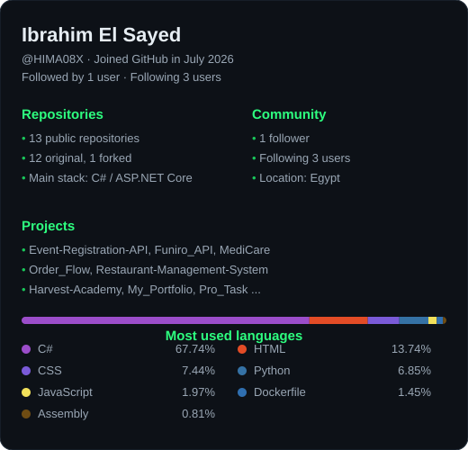

<div align="center">

[](https://github.com/HIMA08X)


</div>


##  About Me

```yaml
name:     Ibrahim El Sayed
role:     Full-Stack ASP.NET Core
location: Egypt
focus:    [Clean Architecture, Cloud Essentials, Design Patterns]
status:   Open to Work
```


##  Achievements & Metrics

<div align="center">

[](https://github.com/HIMA08X)

</div>


##  Tech Stack

<div align="center">

     

    

     

    

 

</div>


##  Connect With Me

<div align="center">

<a href="https://www.linkedin.com/in/ibrahim-sayed-838509345"></a> <a href="mailto:ibrahimelsayed0x@gmail.com"></a> <a href="https://github.com/HIMA08X"></a> <a href="https://hima08x.github.io/My_Portfolio/"></a>

<br/>

*"Habits are the compound interest of self-improvement."* — **James Clear**, *Atomic Habits*

</div>
